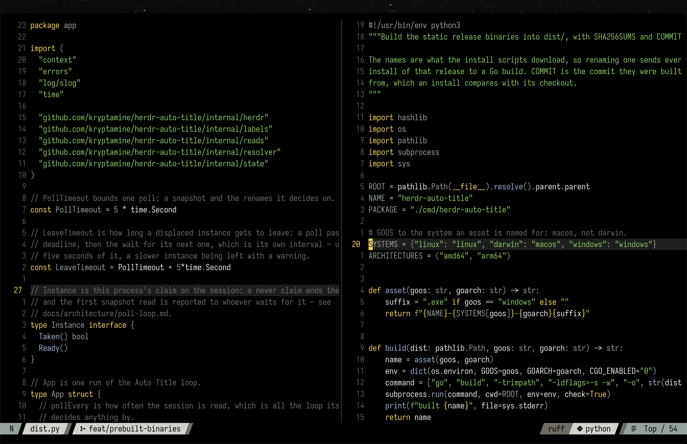

# i-love-volvo

_A dark, minimal Neovim colorscheme based on gruber-darker_

This is a fork of
[kryptamine/gruber-darker-renaissance](https://github.com/kryptamine/gruber-darker-renaissance)
with a few personal tweaks.



A pure black background with near-white names. Each hue has one shade: yellow
keywords, green strings, niagara blue functions, quartz types and constants,
warm ash gray comments. The accents share a lightness and saturation range, so
none of them stands out over the others.

Needs Neovim 0.10 or newer and nothing else.

## Installation

### [lazy.nvim](https://github.com/folke/lazy.nvim)

This fork is vendored at `~/.config/nvim/i-love-volvo`:

```lua
{
  dir = vim.fn.expand("~/.config/nvim/i-love-volvo"),
  name = "i-love-volvo",
  lazy = false,
  priority = 1000,
  config = function()
    require("i-love-volvo").setup({})
    vim.cmd.colorscheme("i-love-volvo")
  end,
}
```

## Configuration

Call `setup()` before loading the colorscheme. Your options are merged over
the defaults.

### Defaults

```lua
require("i-love-volvo").setup({
  bold = true,
  italic = {
    strings = true,
    comments = true,
    operators = false,
    folds = true,
  },
  invert = {
    signs = false,
    tabline = false,
    visual = false,
  },
  undercurl = true,
  underline = true,
  transparent = false, -- leave the window background to the terminal; floats stay opaque
  terminal_colors = true, -- set `g:terminal_color_*`
  sidebars = { "qf", "help" }, -- filetypes with the darker sidebar background
  plugins = {}, -- every integration is on; set one to false, e.g. `snacks = false`
  on_colors = function(colors) end,
  on_highlights = function(highlights, colors) end,
})
```

### Overriding colors and highlights

```lua
require("i-love-volvo").setup({
  on_colors = function(c)
    c.syntax.keyword = c.red
  end,
  on_highlights = function(hl, c)
    hl.FzfLuaTitle = { fg = c.black, bg = c.green }
    hl.FzfLuaDirPart = "Comment" -- a string value is a link
  end,
})
```

`c` holds the raw palette (`c.yellow`, `c.niagara`, `c.ash`) and the semantic
colors built from it (`c.syntax.*`, `c.diag.*`, `c.git.*`, `c.bg_float`); see
[palette.lua](lua/i-love-volvo/palette.lua) and
[colors.lua](lua/i-love-volvo/colors.lua).

Floats and the completion menu share the editor's black background, so they
read best with a border: set `vim.o.winborder` or the plugin's own `border`.

## Extras

Themes for other tools, generated from the same palette, are in `extras/`.
With lazy.nvim that is `~/.local/share/nvim/lazy/i-love-volvo/extras/`.

- Alacritty: link `extras/alacritty/i-love-volvo.toml` somewhere and add
  it to `general.import` in `alacritty.toml`.
- fish: link `extras/fish/i-love-volvo.theme` into
  `~/.config/fish/themes/` and add `fish_config theme choose
  i-love-volvo` to `config.fish`.
- foot (1.24+): add `include=` with the path to
  `extras/foot/i-love-volvo.ini` to `foot.ini`.
- Ghostty: link `extras/ghostty/i-love-volvo` into
  `~/.config/ghostty/themes/` and set `theme = i-love-volvo`.
- herdr: its config cannot include a file, so paste
  `extras/herdr/i-love-volvo.toml` into `~/.config/herdr/config.toml`.
- kitty: link `extras/kitty/i-love-volvo.conf` into
  `~/.config/kitty/themes/` and run `kitten themes`, or `include` it from
  `kitty.conf`.
- lazygit: add `extras/lazygit/i-love-volvo.yml` to
  `LG_CONFIG_FILE`, which takes a comma-separated list of config files.
- Windows Terminal: copy `extras/windows-terminal/i-love-volvo.json`
  into `%LOCALAPPDATA%\Microsoft\Windows Terminal\Fragments\i-love-volvo\`
  and pick "I Love Volvo" in the color schemes.

## Credits

Gruber Darker was made for GNU Emacs by Jason Blevins, after John Gruber's
BBEdit theme. [blazkowolf/gruber-darker.nvim](https://github.com/blazkowolf/gruber-darker.nvim)
was a big help while writing this one.
